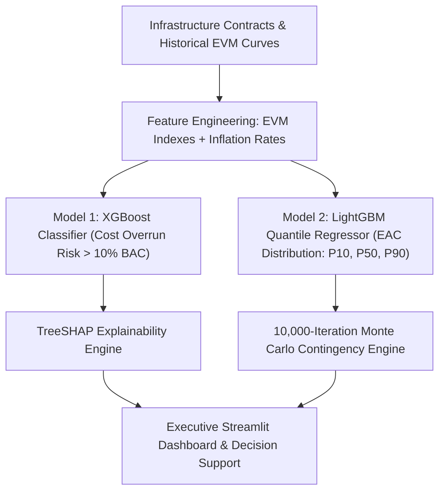

# Megaproject Cost Overrun & Schedule Delay Prediction
### Quantitative Risk Modeling & Early Warning System for Infrastructure Contracts

[](https://xgboost.readthedocs.io/)
[](https://github.com/slundberg/shap)
[-blueviolet)](#)
[](https://streamlit.io/)

A predictive analytics platform designed to solve the multi-billion dollar cost overrun problem in heavy civil engineering megaprojects. Based on Oxford Reference Class Forecasting (RCF) methodologies and empirical data from USDOT/FHWA and Obrasgov public contracts.



## Business Impact
- **Early Risk Detection:** Identifies work packages with >75% probability of exceeding budget contingency 60 to 90 days in advance.
- **Probabilistic EAC:** Quantifies Estimate At Completion with confidence intervals ($P_{10}, P_{50}, P_{90}$) instead of misleading single-point deterministic estimates.
- **Explainable Decisions (CPMAI):** Unpacks exact cost driver contributions (material price spikes, contract delivery method, subsurface delays) using Shapley values.

## Architecture
- `src/data_pipeline.py`: Ingestion and standardization for USDOT/FHWA datasets.
- `src/monte_carlo.py`: Stochastic simulation engine for contingency buffer sizing.
- `app/app.py`: Interactive board-level dashboard.

## Installation & Execution
```bash
git clone https://github.com/master-dev0000/predictive-cost-schedule-risk.git
cd predictive-cost-schedule-risk
pip install -r requirements.txt
streamlit run app/app.py
```

## License
MIT License. Developed by André Belarmino Alves.
